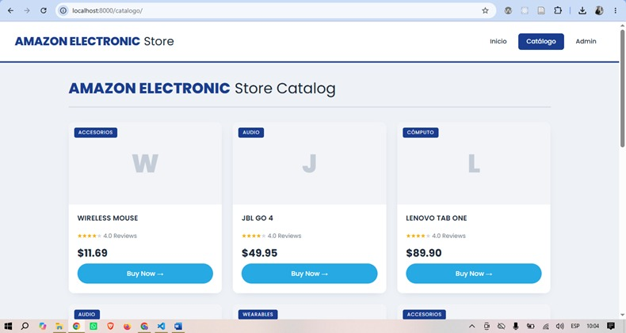
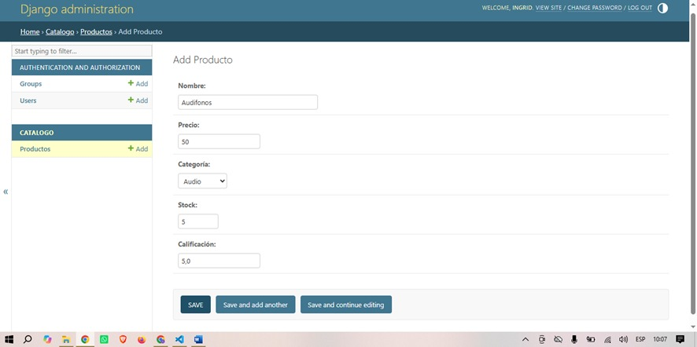
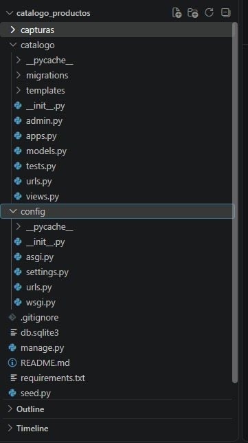

# Catálogo de Productos Tecnológicos — Django (Semana 11 Grupal)

**Asignatura:** Desarrollo de Aplicaciones Web (IS093A) · Unidad II — Desarrollo Web Fullstack
**Tema:** Django 5.x — patrón MTV (Model-Template-View), ORM, FBV y CBV, plantillas con herencia.

Aplicación web "Amazon Electronic Store": un catálogo de productos tecnológicos
construido con Django siguiendo el patrón **MTV**.

---

## Capturas

### Catálogo renderizado


### Panel de administración


### Estructura de carpetas



## Integrantes y roles

| Rol | Integrante | Responsabilidad |
|---|---|---|
| Arquitecto Django | Ingrid Andrade | startproject/startapp, settings.py, urls.py, estructura MTV |
| Desarrollador de Vistas | Ingrid Andrade | FBV + CBV (ListView), contexto, render(), manejo de errores |
| Ingeniero de Plantillas | Ingrid Andrade | Herencia, bloques, tags (for/if), filtros, responsive básico |
| QA & ORM Validator | Ingrid Andrade | makemigrations/migrate, QuerySets, manage.py check, README |

---

## Estructura del proyecto (arquitectura MTV)

```
config/                     configuración del proyecto
├── manage.py
├── requirements.txt
├── .gitignore              excluye db.sqlite3 y __pycache__
├── seed.py                 datos de ejemplo (opcional)
├── config/
│   ├── settings.py         INSTALLED_APPS incluye 'catalogo'
│   ├── urls.py             include('catalogo.urls')
│   └── ...
└── catalogo/               la app
    ├── models.py           modelo Producto (con __str__)
    ├── views.py            home (FBV) + ProductoListView (CBV)
    ├── urls.py             rutas con name para reversibilidad
    ├── admin.py            registro del modelo
    ├── migrations/
    └── templates/catalogo/
        ├── base.html       plantilla base con header, footer y bloque content
        ├── home.html       extiende base (bienvenida)
        └── catalogo.html   extiende base (loop de productos, filtros, if)
```

---

## Diagrama de flujo MTV (Request → URLs → View → Model → Template → Response)

```
  Navegador
     │  1. Request: GET /catalogo/
     ▼
┌──────────────┐
│  config/urls │  2. include('catalogo.urls')
└──────┬───────┘
       ▼
┌──────────────┐
│ catalogo/urls│  3. path('catalogo/') → ProductoListView
└──────┬───────┘
       ▼
┌──────────────┐     consulta ORM      ┌──────────────┐
│    VIEW      │ ────────────────────► │    MODEL     │  Producto (SQLite)
│ ListView     │ ◄──────────────────── │ QuerySet     │
└──────┬───────┘     QuerySet (lazy)   └──────────────┘
       ▼
┌──────────────┐
│  TEMPLATE    │  4. catalogo.html renderiza el 
│ (HTML)       │     (aquí recién se EVALÚA el QuerySet)
└──────┬───────┘
       ▼
  5. Response: HTML con los productos
```

**Equivalencia MTV ↔ MVC:** Model = Model, Template = View (presentación),
View = Controller (lógica). Django renombra el Controller como "View".

---

## Los 2 QuerySets utilizados y lazy evaluation

**QuerySet #1** — en la FBV `home()` (`views.py`):
```python
disponibles = Producto.objects.filter(stock__gt=0)
```
Filtra los productos con stock mayor a 0.

**QuerySet #2** — en la CBV `ProductoListView.get_queryset()`:
```python
Producto.objects.filter(stock__gt=0).order_by("precio")
```
Filtra por stock y además ordena por precio ascendente.

### ¿Qué es "lazy evaluation"?
Un **QuerySet es perezoso (lazy)**: cuando escribes
`Producto.objects.filter(...)`, Django **todavía no consulta la base de datos**.
La consulta SQL real se ejecuta solo cuando el resultado se **usa de verdad**,
por ejemplo al:
- iterarlo en el `` de la plantilla,
- llamar `.count()` o `len()`,
- convertirlo con `list()`.

Esto es eficiente porque permite **encadenar filtros** (`.filter().order_by()`)
sin golpear la base de datos en cada paso: Django arma una sola consulta
optimizada y la ejecuta una única vez, al final.

---

## Cómo ejecutar (paso a paso)

Requiere **Python 3.11+**.

```bash
# 1. (opcional) entorno virtual
python -m venv venv
venv\Scripts\activate        # Windows

# 2. instalar Django
pip install -r requirements.txt

# 3. migraciones
python manage.py makemigrations
python manage.py migrate

# 4. (opcional) poblar datos de ejemplo
python manage.py shell < seed.py   # en PowerShell: Get-Content seed.py | python manage.py shell

# 5. (opcional) superusuario para el admin
python manage.py createsuperuser

# 6. arrancar
python manage.py runserver
```

Abrir:
- **Inicio (FBV):** http://localhost:8000/
- **Catálogo (CBV):** http://localhost:8000/catalogo/
- **Admin:** http://localhost:8000/admin/

---

## Rutas (routing)

| URL | Vista | Tipo | name |
|---|---|---|---|
| `/` | `home` | FBV | `catalogo:home` |
| `/catalogo/` | `ProductoListView` | CBV (ListView) | `catalogo:catalogo` |
| `/admin/` | admin de Django | — | — |

---

## Notas de la rúbrica

- URLs con `name` para **reversibilidad** (``).
- `db.sqlite3`, `__pycache__/` y `.env` en `.gitignore` (**no se suben**).
- `python manage.py check` sin problemas; `runserver` sin errores 500/404.
- Las plantillas renderizan **datos reales** del ORM.
